<p align="center">
  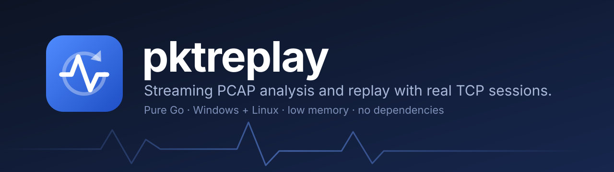
</p>

<p align="center">
  <a href="https://github.com/AlexRudyak/pktreplay/actions/workflows/ci.yml"></a>
  <a href="LICENSE"></a>
  
  
  
  
  <a href="https://www.conventionalcommits.org"></a>
  <a href="https://claude.com/claude-code"></a>
  
</p>

<p align="center">
  <b>Read, filter, analyse and replay PCAP / PCAPNG captures.</b><br>
  Replay as stateless UDP or as a <b>real TCP connection</b> (live handshake, sequence rebasing, retransmission),<br>
  change one conversation without touching the rest, record what was sent, and do it all from a CLI or a friendly local GUI.
</p>

<p align="center">
  <a href="#quick-start">Quick start</a> ·
  <a href="#the-gui">GUI</a> ·
  <a href="#command-line">CLI</a> ·
  <a href="#how-it-works">How it works</a> ·
  <a href="#module-map">Modules</a> ·
  <a href="#building">Build</a> ·
  <a href="README-CLI.md">CLI reference</a> ·
  <a href="docs/ARCHITECTURE.md">Architecture</a>
</p>

> **Use it only on networks you own or are authorised to test.** Replaying traffic, especially with rewritten
> addresses, onto a network you do not control can disrupt other people. See the [disclaimer](#disclaimer).

---

## Why pktreplay

| | |
|---|---|
| **Handles huge captures** | A streaming reader and bounded data structures keep memory flat: a 1.24 GB / 10 M-packet capture is summarised in one pass at 5.8 Mpps with an **11.5 MB** peak working set. |
| **Real TCP, not just packets** | `-mode tcp` opens an actual connection with the target (3-way handshake), then replays the captured client stream with sequence/ACK numbers rebased onto the live connection. Captures that start mid-stream work too. |
| **Explicit, never guessed** | TCP versus UDP is a mandatory choice. Nothing is sent unless you picked it. |
| **Change one conversation** | Analyse a capture, pick conversations from the list, and re-address *just those*; replies stay consistent in both directions. |
| **Precise timing** | Original timing (with speed factor), fixed delay, packets/s, Mbit/s or line rate, on a high-resolution clock. |
| **Two ways to drive it** | A scriptable CLI with leveled logging, and a local web GUI (no extra install) with history and a library of the pcaps you sent. |
| **Pure Go, no dependencies** | Standard library only, no cgo. One codebase builds for Windows and Linux (`amd64`/`arm64`/`386`). |
| **Safe by construction** | GUI listens on loopback only behind a per-launch token; every offset parsed from a packet is bounds-checked; a dry-run backend lets you test without a network. |

## The GUI

Open a capture, tick the conversations you want, choose how to send, press **Send**. Nothing is sent that you did not tick.

<p align="center">
  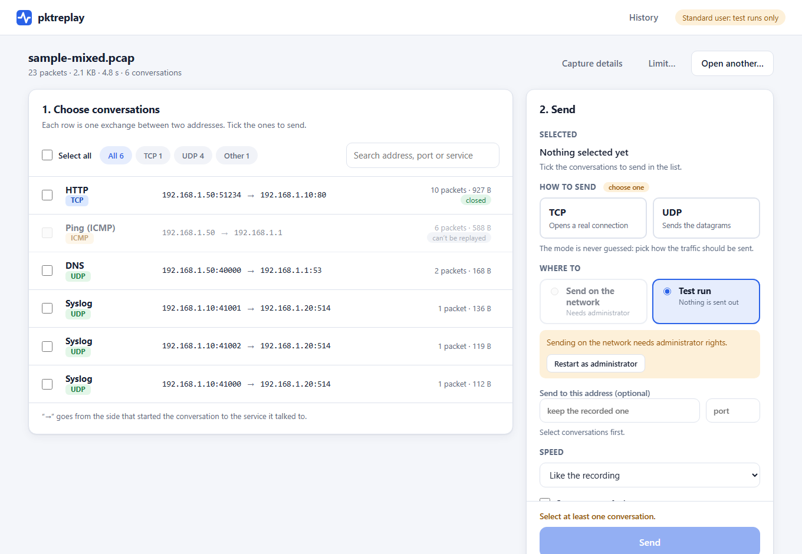
  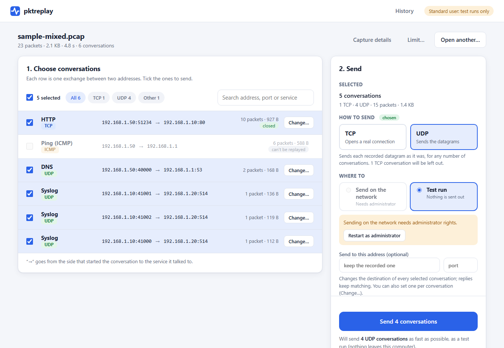
</p>

<p align="center">
  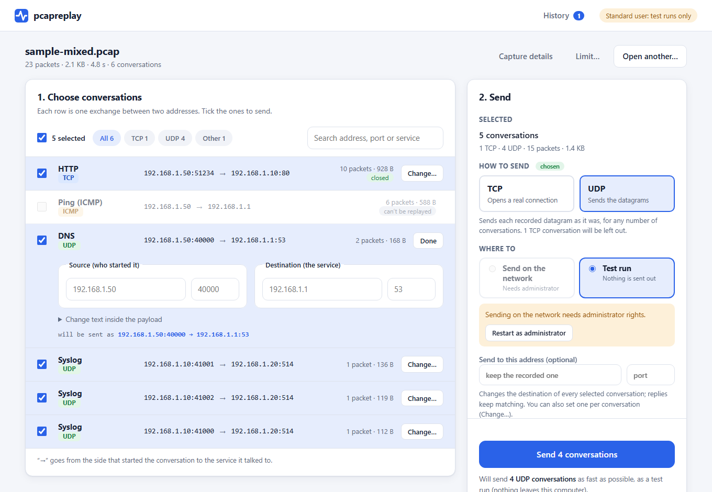
  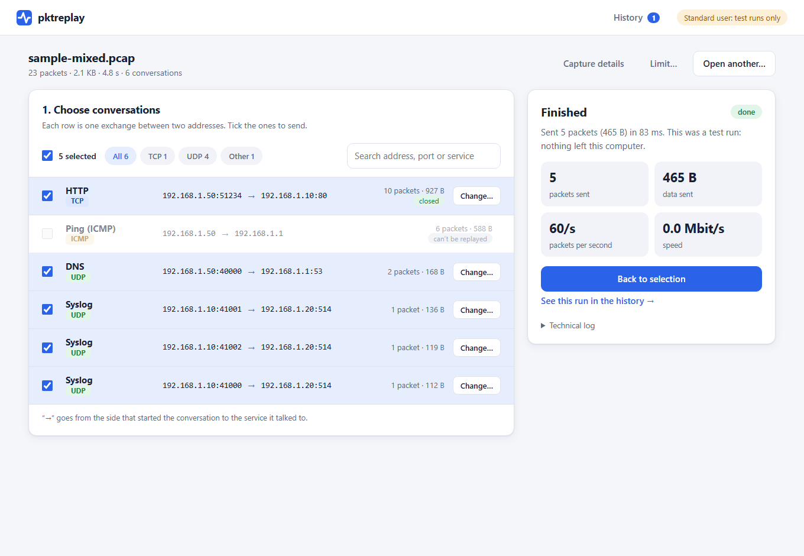
</p>

<details>
<summary><b>More screenshots</b> (welcome screen, history, run details, dark theme)</summary>
<br>
<p align="center">
  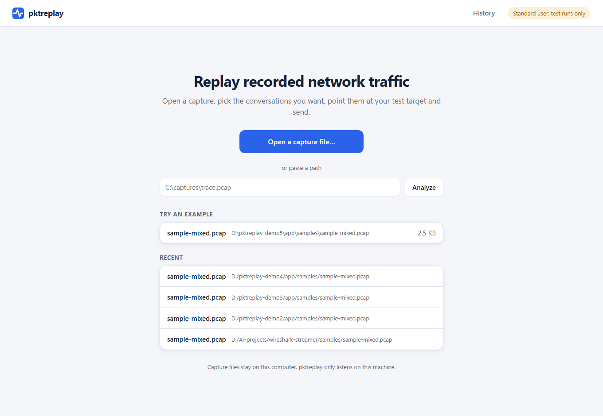
  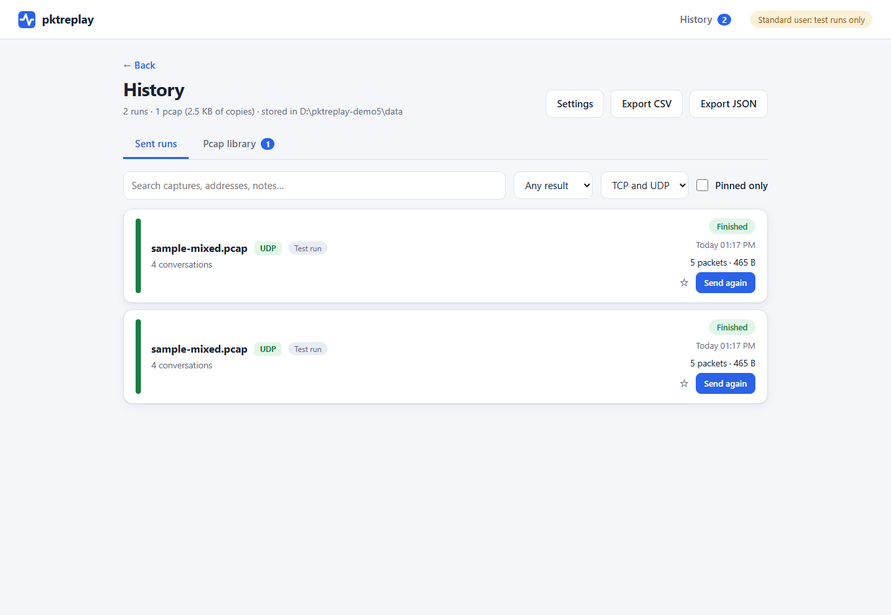
</p>
<p align="center">
  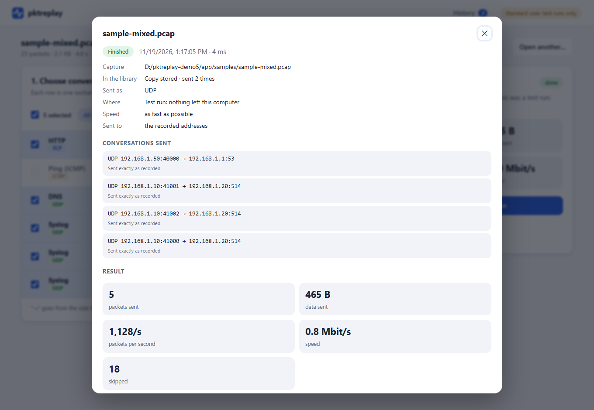
  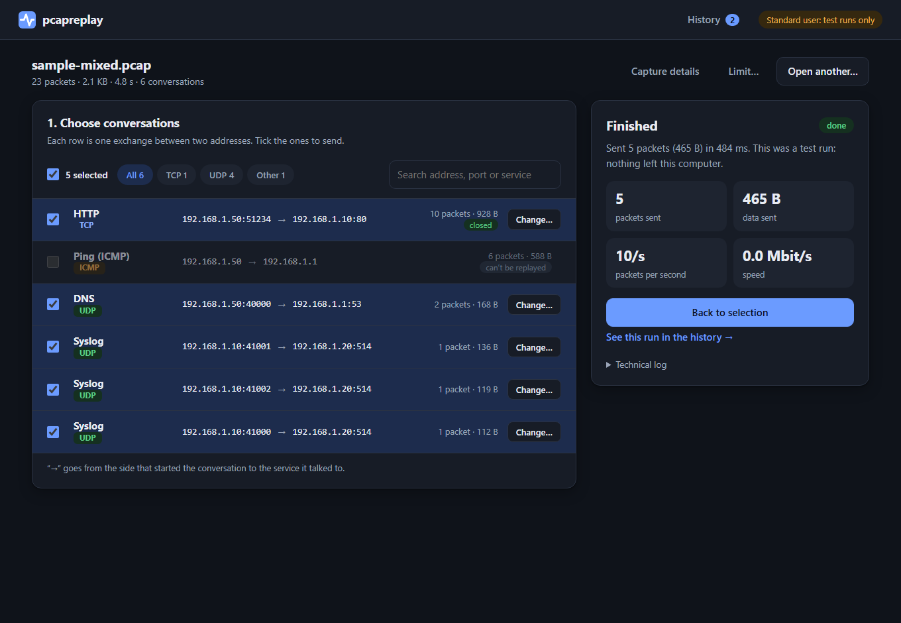
</p>
</details>

The interface is a flow, not a set of tabs: **1. choose conversations**, **2. send**. It also keeps a **history** of
every run (search, pin, annotate, export, *Send again*) and a **library of the pcap files you sent** (stored once by
content hash, so a run can be repeated even if the original file moved). Details: [internal/gui](internal/gui/README.md)
and [internal/history](internal/history/README.md).

## Quick start

### Windows installer

Download `pktreplay-setup-<version>.exe` from the Releases page (or build it, see [installer](installer/README.md)),
run it and start **pktreplay** from the Start Menu. Use **pktreplay (Administrator)** when you want to put packets on the
network; analysis and test runs need no privileges. The installer can also add `pktreplay` to your `PATH`.

### From source

```bash
git clone https://github.com/AlexRudyak/pktreplay.git
cd pktreplay
go build -o bin/pktreplay ./cmd/pktreplay        # Go 1.22+, nothing else to download

bin/pktreplay gui                                # opens the web interface
bin/pktreplay stats samples/sample-mixed.pcap    # a first look at the bundled capture
```

### A 60-second tour (no privileges, no network)

```bash
# What is in the capture, and who talks to whom?
pktreplay stats samples/sample-mixed.pcap
pktreplay conversations samples/sample-mixed.pcap

# Dry run: read, filter, rewrite and "send" to the null backend
pktreplay replay -mode udp -backend null -burst -dst-ip 10.9.9.9 samples/sample-mixed.pcap

# See exactly what happens, packet by packet
pktreplay replay -mode udp -backend null -burst -vvv samples/sample-mixed.pcap
```

To send for real, run as root / Administrator (see [Platform setup](#platform-setup)) and drop `-backend null`.

## Command line

```
pktreplay stats          [flags] <capture>   one-pass summary statistics
pktreplay conversations  [flags] <capture>   list bidirectional conversations
pktreplay index          [flags] <capture>   build a seek index for very large captures
pktreplay replay -mode tcp|udp [flags] <capture>
pktreplay gui            [flags]             local web interface
```

```bash
# UDP at 100 Mbit/s, looped, with a payload substitution
sudo pktreplay replay -mode udp -mbps 100 -loop 10 -replace "tenant-a=>tenant-b" capture.pcap

# A real TCP session towards another host
sudo pktreplay replay -mode tcp -filter "dst_port == 8080" -dst-ip 10.20.0.5 -vv capture.pcap

# Mid-stream capture, starting 1500 bytes into the client stream
sudo pktreplay replay -mode tcp -dst-ip 10.20.0.5 -tcp-skip-bytes 1500 midstream.pcap

# Change ONE conversation (copy the selector from `pktreplay conversations`), leave the rest alone
sudo pktreplay replay -mode udp -only-conv \
     -conv "udp/192.168.1.50:40000/192.168.1.1:53,server-ip=10.50.0.9,server-port=5353" capture.pcap

# Save exactly what was transmitted (and the target's replies) for Wireshark
sudo pktreplay replay -mode tcp -dst-ip 10.20.0.5 -record sent.pcapng capture.pcap
```

Every command and flag, the filter language, pacing, TCP options, logging levels (`-v`, `-vv`, `-vvv`) and a
troubleshooting table are in **[README-CLI.md](README-CLI.md)**.

## How it works

### The pipeline

<p align="center">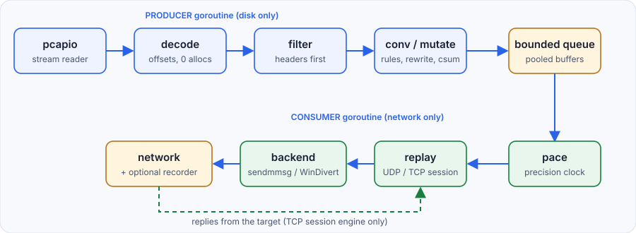</p>

A **producer** goroutine streams the capture, decodes headers without allocating, applies the filter (header tests
before payload tests), resolves the rewrite for the packet's conversation, repairs lengths and checksums, and pushes
pooled buffers into a **bounded queue**. A **consumer** goroutine takes them out, waits on the precision pacer and
injects them through the platform backend. A full queue blocks the reader (memory stays flat); an empty queue only
delays sending (a slow disk can never make timing *earlier*).

### UDP mode: stateless injection

Each selected UDP datagram is rewritten (addresses, ports, payload), its IP/UDP lengths and checksums are recomputed,
and it is injected as an IP datagram at the scheduled time. Many conversations can be sent in one run.

### TCP mode: a real session

The tool plays the *client* of one captured flow against a live server. The kernel knows nothing about the injected
connection and would reset it, so the backend first **guards** the flow (Linux: a temporary nftables/iptables rule
dropping the kernel's RST; Windows: [WinDivert](https://github.com/basil00/WinDivert) diverts the flow's inbound packets so the stack never sees them).

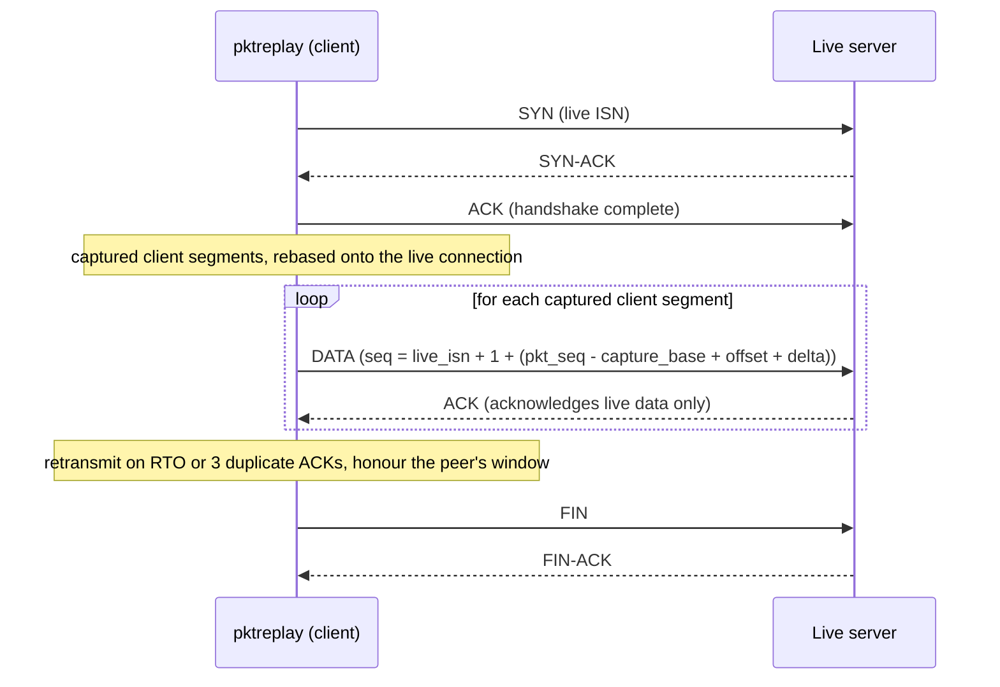

Server packets in the capture are never sent: the live server produces its own. If the capture starts mid-stream (no
SYN), the first data packet anchors the stream; `-tcp-skip-bytes` and `-tcp-seq-offset` adjust the mapping, and
`delta` keeps the stream contiguous when payload rewrites change lengths. The exact formulas, wraparound handling and
retransmission rules are in [docs/ARCHITECTURE.md](docs/ARCHITECTURE.md).

### Conversations and per-conversation rewrites

A **conversation** is a protocol plus an unordered pair of endpoints, so both directions share one key. A **rule**
speaks in endpoints (“the server is now 10.50.0.9”), so client-to-server packets get a new *destination* and
server-to-client packets a new *source*, consistently. A conversation with a rule is not touched by the global
`-dst-ip`-style flags. Selector syntax: `proto/client/server`, e.g. `udp/192.168.1.50:40000/192.168.1.1:53`.

### Pacing, backends, recording, history

| Concern | Approach |
|---|---|
| **Pacing** | An absolute schedule (a late packet never delays later ones; long stalls re-base the clock instead of bursting). Hybrid wait: `Sleep` until ~2 ms before the deadline, then spin on the monotonic clock; on Windows the spin reads `QueryPerformanceCounter`. |
| **Linux backend** | `AF_PACKET` raw sockets with batched `sendmmsg(2)`; next-hop MAC from the neighbour table, default gateway or an ARP probe; nftables (falling back to iptables) for the RST drop. |
| **Windows backend** | WinDivert loaded lazily from `WinDivert.dll` (no cgo), `WinDivertSendEx` batches, a guard filter that diverts the flow's inbound packets and discards outbound RSTs. |
| **Null backend** | Discards packets; lets you test and benchmark the whole pipeline without privileges. |
| **Recording** | A wrapper around any backend: records exactly what was accepted for transmission (and replies), as raw-IP PCAP/PCAPNG with nanosecond timestamps and direction flags. |
| **History** | A dependency-free append-only log (fsync per record, crash tolerant) plus a content-addressed library of the sent pcaps. |

## Module map

Everything lives under `internal/` (nothing is importable from outside) plus three commands under `cmd/`. Each package
has its own README explaining its API, invariants and design decisions.

| Package | Responsibility |
|---|---|
| [`cmd/pktreplay`](cmd/pktreplay/README.md) | The CLI: command dispatch, flags, logging flags, Windows console/log handling, single-instance GUI. |
| [`cmd/pcapgen`](cmd/pcapgen/README.md) | Synthetic capture generator for tests, benchmarks and the sample file. |
| [`cmd/mkicon`](cmd/mkicon/README.md) | Renders the Windows `.ico` with the standard library. |
| [`internal/pcapio`](internal/pcapio/README.md) | Streaming PCAP/PCAPNG reader (zero-alloc `Next`), sparse seek index, direction flags. |
| [`internal/decode`](internal/decode/README.md) | Zero-allocation Ethernet/VLAN/IPv4/IPv6/TCP/UDP/ICMP header decoder producing offsets. |
| [`internal/filter`](internal/filter/README.md) | Boolean filter language compiled to cost-ordered closures. |
| [`internal/stats`](internal/stats/README.md) | One-pass bounded-memory statistics: Space-Saving top talkers, port tables, conversation rows. |
| [`internal/conv`](internal/conv/README.md) | Conversation tracking, role detection, selectors and per-conversation rewrite rules. |
| [`internal/checksum`](internal/checksum/README.md) | RFC 1071 checksums with pseudo-headers. |
| [`internal/craft`](internal/craft/README.md) | Builds Ethernet/IP/TCP/UDP frames (handshake segments, test traffic). |
| [`internal/mutate`](internal/mutate/README.md) | Pooled packet buffers, rewrites (IP/port/payload/substitution) and checksum repair. |
| [`internal/pace`](internal/pace/README.md) | Precision pacing: original timing, fixed delay, pps, Mbit/s, burst. |
| [`internal/backend`](internal/backend/README.md) | `Backend` interface; Linux AF_PACKET, Windows [WinDivert](https://github.com/basil00/WinDivert), null. |
| [`internal/replay`](internal/replay/README.md) | The producer/consumer pipeline, the UDP engine and the TCP session engine. |
| [`internal/record`](internal/record/README.md) | Backend wrapper that writes transmitted traffic to PCAP/PCAPNG. |
| [`internal/history`](internal/history/README.md) | Run history store and content-addressed pcap library. |
| [`internal/gui`](internal/gui/README.md) | Local web server, job manager, HTTP API, embedded frontend. |
| [`internal/logx`](internal/logx/README.md) | Small leveled logger behind `-v/-vv/-vvv`. |

Main dependency directions (arrows point at what is used; leaf packages such as `backend`, `pace`, `pcapio` and
`checksum` import nothing from this project):

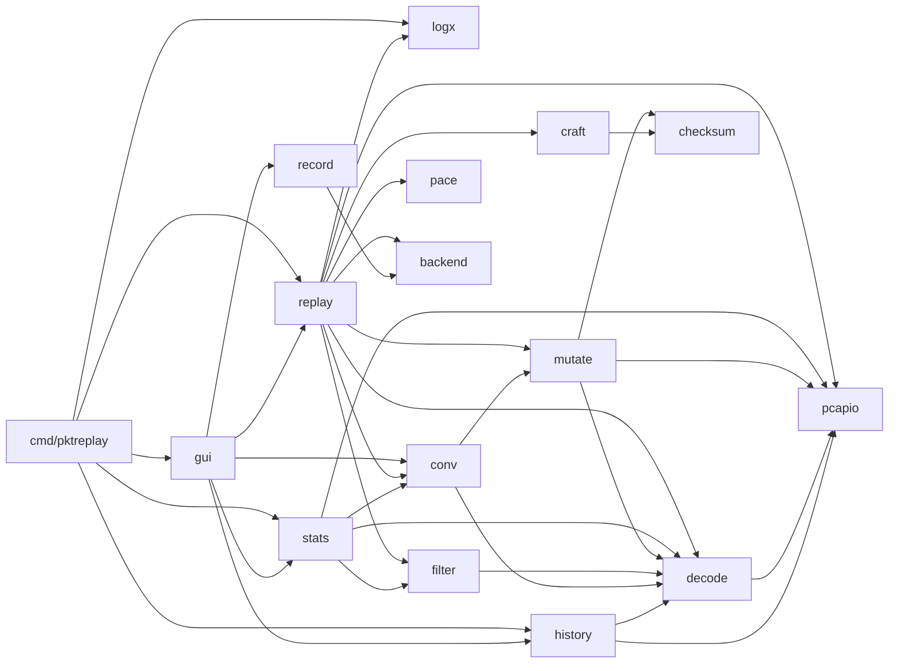

## Repository layout

```
cmd/            pktreplay (CLI), pcapgen (test data), mkicon (icon)
internal/       the libraries listed above, one directory each, each with a README.md
docs/           ARCHITECTURE.md (design, formulas, measurements) and assets/ (logo, diagrams, screenshots)
installer/      Inno Setup script, build and WinDivert-fetch scripts for the Windows installer
scripts/        Linux end-to-end tests that replay into a real kernel (veth + network namespace)
samples/        sample-mixed.pcap, a 23-packet capture you can open right away
README-CLI.md   complete command-line reference
```

## Building

Go 1.22 or newer. No other tools are needed.

```bash
go build -o bin/pktreplay ./cmd/pktreplay
go test ./...                       # unit tests
go test -race ./...                 # with the race detector (needs a C toolchain on some platforms)

# cross-compile (cgo is not used)
GOOS=linux   GOARCH=amd64 go build -o bin/pktreplay-linux       ./cmd/pktreplay
GOOS=linux   GOARCH=arm64 go build -o bin/pktreplay-linux-arm64 ./cmd/pktreplay
GOOS=windows GOARCH=amd64 go build -o bin/pktreplay.exe         ./cmd/pktreplay
```

Version information is set at link time: `-ldflags "-X main.version=1.2.3"`. The Windows installer is built with
`powershell -File installer\build.ps1` (see [installer/README.md](installer/README.md)).

## Platform setup

**Linux.** Raw sockets need `CAP_NET_RAW`; the automatic RST-drop rule also needs `CAP_NET_ADMIN`. The simplest option
is `sudo`; alternatively `sudo setcap cap_net_raw,cap_net_admin+ep ./pktreplay`. In TCP mode pktreplay installs a
temporary nftables table dropping the kernel's RSTs for exactly the replay 4-tuple and removes it afterwards (use
`-no-firewall` to manage it yourself).

**Windows.** Sending on the network needs an elevated prompt and the [WinDivert](https://github.com/basil00/WinDivert) 2.2.x files (`WinDivert.dll`,
`WinDivert64.sys`, from the [official releases](https://github.com/basil00/WinDivert/releases)) next to `pktreplay.exe`; the installer bundles them when they were staged at build time. Some
antivirus products flag WinDivert because the same technique is used by malware. Loopback targets are not supported
by WinDivert network-layer injection. Analysis, conversation lists, dry runs and recording need no privileges.

## Security model

* The GUI binds to **loopback only** and refuses any other address. Every request needs a random per-launch token
  (the printed URL carries it; it is exchanged for an `HttpOnly`, `SameSite=Strict` cookie). `Host`, `Origin` and
  content-type checks defend against DNS rebinding and cross-site requests. Do not forward its port.
* Because the tool can inject packets, it can do harm. Elevated privileges are only needed to put packets on a
  network; everything else runs as a normal user.
* Parsers treat capture files as hostile input: every length and offset is validated before use, fragments and
  truncated frames are handled, and the history API validates identifiers before building paths.
* The history CSV export neutralises spreadsheet formula injection.

## Measured performance

Measured on one machine (AMD Ryzen 7 6800HS, Windows 11, NVMe). Treat numbers as indicative.

| Test | Result |
|---|---|
| `stats` on a 1.24 GB / 10 M-packet pcap | 5.76 Mpps, 748 MB/s, **11.5 MB peak working set** |
| `stats` on a 2 M-packet pcapng | 3.0 Mpps, 443 MB/s |
| Header filter evaluation | 28 ns per packet, 0 allocations |
| Checksum of a 1500-byte frame | 5.3 GB/s |
| UDP pipeline with rewrite (null backend) | ~0.9 Mpps |
| Real Linux kernel (WSL2, veth + netns), UDP | 33 226 of 33 226 datagrams delivered at a 20 k pps pace |
| Real Linux kernel, TCP (handshake, mid-stream, skip-bytes) | stream delivered byte for byte, clean FIN/ACK close, firewall rule removed |

Reproduce with `cmd/pcapgen` and `go test -bench` (see [docs/ARCHITECTURE.md](docs/ARCHITECTURE.md) and
[scripts/README.md](scripts/README.md)).

## Testing

* Unit and integration tests for every package (`go test ./...`), including a TCP engine tested against an in-process
  TCP peer over a fake backend, sequence wraparound, retransmission, and the GUI HTTP API.
* End-to-end scripts replay into a real kernel TCP/UDP server inside a network namespace (Linux or WSL2, root):
  [scripts/README.md](scripts/README.md).

## Known limitations

* The **WinDivert backend** compiles and is unit-tested for structure layout and filter generation, and its DLL
  loading and error handling were exercised, but raw injection through the driver has **not been run end to end**
  by the author. Treat it as untested on real hardware until you try it elevated with the official files.
* TCP mode replays the client-to-server stream of **one** flow per run and negotiates only MSS (no window scaling or
  SACK). UDP mode can send many conversations.
* Frames larger than the path MTU are injected as they are (no fragmentation).
* PCAPNG seeking assumes a single section.
* Linux uses one next-hop MAC per run; use `-dst-mac` when conversations are rewritten to different subnets.

More detail: [docs/ARCHITECTURE.md](docs/ARCHITECTURE.md).

## Contributing

Contributions are welcome. Please read [CONTRIBUTING.md](CONTRIBUTING.md) first: it covers the layout, how to run the
tests, the commit convention (Conventional Commits) and what a good pull request looks like. Security issues:
[SECURITY.md](SECURITY.md).

## License

[MIT](LICENSE). The Windows installer can bundle the **[WinDivert](https://github.com/basil00/WinDivert)** driver by basil00, a separate
project under LGPLv3/GPLv2 (dual licensed); it is *not* part of this repository and must be used unmodified under its own
license. See [THIRD_PARTY.md](THIRD_PARTY.md).

## Disclaimer

pktreplay can transmit forged and replayed network traffic. You are responsible for using it lawfully and only on
networks, hosts and data you own or have explicit permission to test. The software is provided as is, without
warranty (see the license).

## Made by Claude

This project, including the code, tests, documentation and this README, was written by
[Claude](https://claude.com/claude-code) (Anthropic's AI model, via Claude Code) working with its owner, who set the goals and
reviewed the results through many iterations. See the commit history for how it grew.
